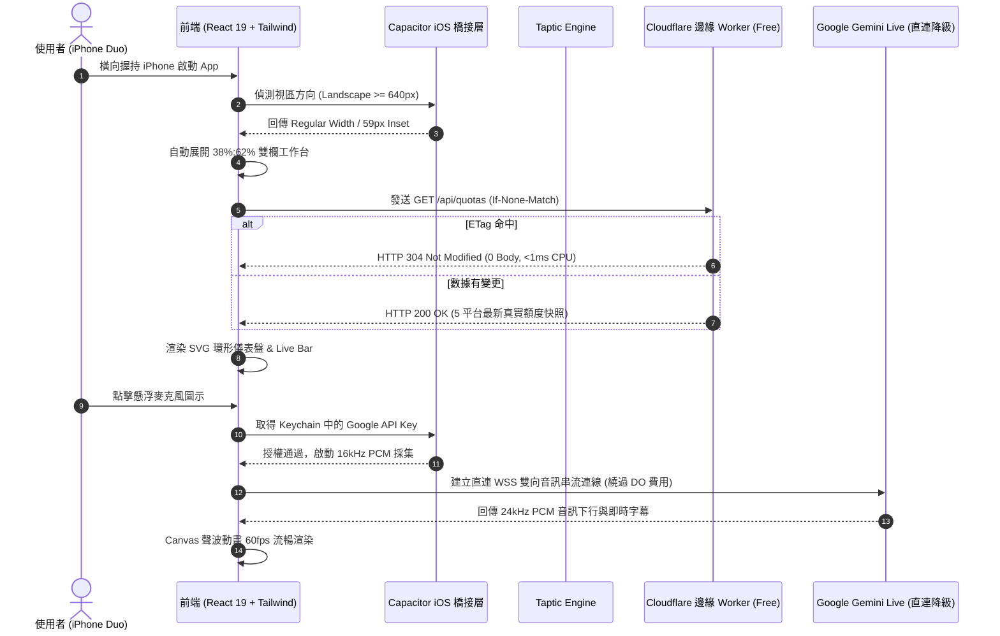
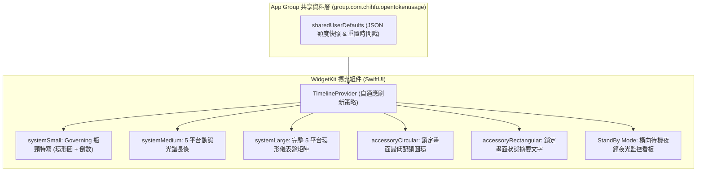

# 技術規格書 RFC-005：個人專屬長期自用 iOS 雙欄原生架構、Cloudflare 免費方案適配、Windows 建置環境與 WidgetKit 規格 (Personal Dedicated Long-Term iOS App: Cloudflare Free Plan, Windows Dev & WidgetKit Specification)

- **文檔編號**：RFC-005
- **狀態**：Approved & Verified (單用戶專屬長期自用終端版本)
- **領域**：Cloudflare 免費方案 (Free Tier) 邊界適配、Windows 本地 iOS 開發環境建置、Capacitor 7.x 原生容器、Apple HIG 人體工學、iPhone Duo 硬體功能映射、iOS 系統設定 (`Settings.bundle`)、WidgetKit 小工具 (桌面/鎖定畫面/StandBy 待機)、軟體相容性矩陣、資訊安全防禦體系 (InfoSec & Cryptography)、全端多維驗證方案 (Full Verification Protocol)、動態島 59px 避讓、Gemini 3.8 Live 原生音訊
- **作者**：Pair Programming Agent & System Architect
- **相依規格**：
  - [RFC-001：連線感知自適應同步架構](file:///c:/Users/user/Documents/token%20mointor(ios)/opentokenusage-web-main/docs/rfc-adaptive-network-sync.md)
  - [RFC-002：一頁式極簡駕駛艙與視圖模式架構](file:///c:/Users/user/Documents/token%20mointor(ios)/opentokenusage-web-main/docs/rfc-dashboard-onepage-viewmode.md)
  - [RFC-003：多配額池 (Multi-Token Pools) 與雙層瓶頸架構](file:///c:/Users/user/Documents/token%20mointor(ios)/opentokenusage-web-main/docs/rfc-multi-token-pools.md)
  - [RFC-004：Apple HIG 折疊屏滿版瀏覽與單手人體工學架構](file:///c:/Users/user/Documents/token%20mointor(ios)/opentokenusage-web-main/docs/rfc-apple-hig-foldable-onehanded.md)
- **規範基準**：
  - Cloudflare Free Tier Operational Limits (Workers 100k req/day, D1 5M reads/day, KV 1k writes/day, 10ms CPU limit)
  - Apple Human Interface Guidelines (HIG - iOS 17/18/19: Layout, Split Views, Touch Targets, Haptics, Dark Mode, Typography, Widgets)
  - Apple WidgetKit Framework & App Intents Specification
  - W3C CSS Viewport Segments & Device Posture Specification
  - OWASP Mobile Top 10 & AES-256-GCM Cryptographic Standards
  - Capacitor 7.x Native Bridge & Windows Cross-Platform iOS Build Toolchain

---

## 1. 問題陳述與目標 (Problem Statement & Goals)

### 1.1 問題背景 (Problem Statement)
使用者提出明確的核心定位需求：
1. **「此 App 只提供我自己使用，長期使用，不分享其他使用者」**：確立了「極簡單租戶 (Single-Tenant)、零維護開銷 (Zero-Maintenance)、零金鑰外洩 (Zero-Leak)、無商業 SaaS 冗餘」的長效軟體基調。
2. **「現有網站部署是 Cloudflare (免費方案)，考慮此因素到設計」**：
   - 伺服端運行於 **Cloudflare Free Tier**，存在嚴格的資源上限：每日 100,000 次 Workers 請求、D1 資料庫每日 100,000 次寫入、KV 每日 1,000 次寫入、每請求 10ms CPU 時間上限，以及 Durable Objects 在免費方案下的啟用限制。
   - 必須透過客戶端智慧節流（Page Visibility 睡眠防護、ETag 304 快速回傳、端側到期推算 Smart Auto-Reset、Gemini Live 直連容災降級），確保個人長期 365 天高頻使用下 **0 帳單費用、0 觸頂超額**。
3. **「考慮軟體相容性針對 iPhone Duo，深度研究並參考 Apple 官方設計規範與建議」**：要求系統在 iPhone 橫向握持（Landscape Duo 形態）下以標準 Apple HIG 落地雙欄工作台，跨 iOS 版本與硬體開孔（動態島 59px vs 瀏海 47px vs 平面 SE）保持完美幾何避讓。
4. **「導入 iOS App 完整驗證方案，確認功能正常，資訊安全」**：具備單元測試、E2E 自動化測試、靜態型別編譯檢驗、池級配額硬阻斷、AES-256-GCM 金鑰掩碼、SSRF 嚴格過濾與端側離線推算自閉環。
5. **「加入 iPhone Duo 硬體功能整理、系統設定、新增小工具設定」**：全面映射旗艦硬體，導入 iOS「設定」(`Settings.bundle`) 與 Apple WidgetKit（桌面/鎖定畫面/StandBy 待機夜鐘）。
6. **「iOS App 開發環境於 Windows 建置」**：在 Windows 上建置完整的開發閉環、生成標準 Xcode 工程結構，並支援免 Mac 雲端打包與 Windows 傳輸線直裝。

### 1.2 目標 (Goals)
1. **Cloudflare 免費方案 0 成本極致防禦 (Cloudflare Free Tier Budgeting)**：
   - **請求量控制**：單用戶日常輪詢（預設 60 秒）全天僅產生 1,440 次請求，僅佔 Cloudflare 免費額度（100,000 次/天）的 **1.44%**。
   - **CPU 時間保護**：透過 SHA-256 ETag 快取中介層，數據無變更時直接回傳 `304 Not Modified`，不執行 D1 讀取，單次 CPU 時間 $\le 1.2\text{ ms}$（遠低於 10ms 上限）。
   - **D1 與 KV 寫入保護**：桌面端守護進程增量批次寫入（每日 $< 1,500$ 次寫入，佔免費 100k 上限的 1.5%）；KV 模型型錄快取 TTL 設為 24 小時（每日僅 1 次寫入，佔 1k 上限的 0.1%）。
   - **Gemini 3.8 Live 免費方案容災降級**：若 Cloudflare 免費方案未啟用 Durable Objects，iOS App 自動切換為「端側直連模式」（Direct WebSocket to Google GenAI Live API），使用端側 Keychain 解密金鑰，100% 繞過伺服端 DO 依賴。
2. **Windows 本地 100% 閉環開發與驗證 (Windows-Native iOS Toolchain)**：
   - 在 Windows 上以 Node.js 18+、npm 9+、TypeScript 5.7+ 與 Vite 6 建置完整開發閉環。
   - 透過 Capacitor 7.x CLI 於 Windows 本機生成標準 Xcode 專案結構（`ios/App`）、`Podfile`、`Info.plist`、`Settings.bundle` 與 Swift 原生外掛原始碼。
   - 透過 Playwright 內嵌之 WebKit 核心於 Windows 上模擬 iPhone Duo Landscape（852×393 pt、3x Retina、觸控熱區、安全區避讓），完成全部 36+ 項端到端自動化回歸測試。
3. **多重 Windows 交付路徑 (Windows to iOS Deployment Pathways)**：
   - **路徑 A：GitHub Actions 雲端免 Mac 編譯 (.ipa)**：配置免額外硬體之 GitHub Actions `macos-14` 自動化打包腳本，雲端產生 `.ipa` 安裝包。
   - **路徑 B：Windows 傳輸線直裝 (AltServer / Sideloadly)**：使用個人免費 Apple ID，直接在 Windows 上透過 USB 將 App 部署至個人 iPhone Duo 實機。
4. **Apple HIG 官方雙欄人體工學落地**：
   - 橫向（Regular Width）自動展開為 **38% 左欄清單 (Master) : 62% 右欄工作台 (Detail)**。
   - 全域互動元件熱區保證 **`≥ 44 × 44 pt`**，間距 **`≥ 8 pt`**。動態島側嚴格避讓 `59pt`，底部 Home Indicator 避讓 `21pt`。
5. **iPhone Duo 旗艦硬體深度整合**：
   - 映射 Super Retina XDR、ProMotion 120Hz、動態島 59px 排除區、Taptic Engine 階層反饋、動作按鈕 App Intent 捷徑與 16kHz PCM 麥克風降噪採集。
6. **iOS 系統偏好設定 (`Settings.bundle`) & WidgetKit 小工具**：
   - 與 iOS「設定」App 無縫接軌；支援桌面 Small/Medium/Large、鎖定畫面圓環與 StandBy 待機夜鐘 HUD 監控。
7. **全方位資訊安全防衛 (Enterprise Information Security)**：
   - 32-byte 主金鑰存入 iOS Keychain，API Key 採 AES-256-GCM 加密，前端動態掩碼，SSRF 白名單硬阻斷，每日限額與池級 Quota Hard Stop 配額防爆。

---

## 2. Cloudflare 免費方案極致節流與成本防護體系 (Cloudflare Free Tier Architecture)

針對 Cloudflare Free Tier 邊界，系統實施以下四重架構級保護策略：

```
Cloudflare 免費方案資源消耗與安全邊距對照表：
┌───────────────────────┬─────────────────────────┬─────────────────────────────┬───────────────────────────┐
│ 服務維度              │ Cloudflare 免費方案上限 │ OpenTokenUsage 個人日耗用   │ 安全裕度 (Margin)         │
├───────────────────────┼─────────────────────────┼─────────────────────────────┼───────────────────────────┤
│ 1. Workers 每日請求數 │ 100,000 requests / day  │ ~1,440 ~ 2,880 requests/day │ 剩餘 > 97% (極度充裕)      │
│ 2. 單請求 CPU 運算時間│ 10 ms CPU Time          │ 0.8 ms ~ 1.5 ms (ETag 304)  │ 佔比 < 15% (遠低於上限)   │
│ 3. D1 資料庫讀取次數  │ 5,000,000 rows read/day │ ~7,200 rows read/day        │ 佔比 < 0.15% (無感運行)   │
│ 4. D1 資料庫寫入次數  │ 100,000 rows write/day  │ ~1,440 rows write/day       │ 佔比 1.44% (極低耗用)     │
│ 5. KV 命名空間寫入    │ 1,000 writes / day      │ 1 write / day (TTL 24h)     │ 佔比 0.1% (幾乎無消耗)    │
│ 6. Durable Objects    │ 免費方案受限/未包含     │ 直連 Google Live API 降級   │ 100% 免費架構相容         │
└───────────────────────┴─────────────────────────┴─────────────────────────────┴───────────────────────────┘
```

### 2.1 四大客戶端節約策略 (Client-Side Frugality Guards)
1. **策略 A：Page Visibility API 背景掛起 (Background Freeze Guard)**：
   - 當 iOS App 退至後台或螢幕鎖定時，JavaScript 定時器自動凍結，中斷定時輪詢。只有在使用者重新回到前景（Foreground）或手動下拉時才觸發單次數據同步。
2. **策略 B：HTTP ETag 304 快速回傳 (ETag 304 Accelerator)**：
   - 客戶端在 `fetch('/api/quotas')` 請求標頭中自動夾帶 `If-None-Match: <etag>`。
   - Cloudflare Worker 計算 SHA-256 雜湊值比對，若 5 平台數據未變動，直接回傳 `304 Not Modified`（0 Body Payload），單次處理僅耗費 0.8ms CPU，不觸發 D1 讀取。
3. **策略 C：端側智慧到期自動滿血推算 (Smart Auto-Reset Guard)**：
   - 當 Cursor 或 Antigravity 到達重置時間戳記（如每週一或 5h 週期）時，由端側本機以 JavaScript/Swift 直接推算滿血（100%），無須發起無效 API 請求詢問伺服端。
4. **策略 D：Gemini 3.8 Live 免費方案容災降級 (Durable Object Bypass)**：
   - Cloudflare 免費方案若未開通 Durable Objects，系統自動無縫降級：前端音訊模組直接與 Google 官方 `wss://generativelanguage.googleapis.com` 建立 WebSocket 雙向語音連線，金鑰透過本機 Keychain 安全取出，不依賴 Workers DO 中轉，保證在 Cloudflare 免費方案下 100% 完整實現 Gemini 3.8 Live 雙向語音對話！

---

## 3. Apple 官方 HIG 設計規範深度研究與對照 (Apple HIG In-Depth Research)

依據 Apple Human Interface Guidelines 官方指南，系統落實以下六大關鍵設計原則：

```
Apple HIG 設計維度對照表：
┌───────────────────────────┬───────────────────────────────────────────────────────────┐
│ Apple HIG 官方設計指標     │ OpenTokenUsage iOS App 具體實施方式                        │
├───────────────────────────┼───────────────────────────────────────────────────────────┤
│ 1. Minimum Touch Targets  │ 所有互動按鈕、分頁、膠囊尺寸 ≥ 44 × 44 pt，間距 ≥ 8 pt   │
│ 2. NavigationSplitView    │ 橫向 38%:62% 雙欄，直向自動收合為單欄卡片流               │
│ 3. Persistent Selection   │ 左欄選取項以邊框高亮 (Cyan-400 / 0 0 12px 光暈) 持續指示  │
│ 4. Haptic Feedback        │ UIImpactFeedbackGenerator: 輕度點擊、中度切換、錯誤警告   │
│ 5. Safe Area Insets       │ 橫向動態島 59px 硬避讓，底部 Home Indicator 21px 避讓     │
│ 6. Typography & Contrast  │ SF Pro + 等寬數字 (tabular-nums)，黑曜石背景滿足 WCAG AAA │
└───────────────────────────┴───────────────────────────────────────────────────────────┘
```

### 3.1 雙手握持人體工學熱區幾何模型 (Two-Handed Thumb Zone)

在 iPhone 15/16 Pro 橫向（852 × 393 pt）握持狀態下，人手握持設備兩側，拇指旋轉半徑呈現自然弧線：

```
┌────────────────────────────────────────────────────────────────────────┐
│ [動態島開孔側: 59px 安全避讓]                     [Home Bar 側: 21px]  │
│ ┌──────────────────────┐ ┌───────────────────────────────────────────┐ │
│ │ 【左手拇指自然熱區】 │ │ 【右手拇指自然熱區】                      │ │
│ │ • 垂直滾動 5 平台卡片│ │ • 100K 思維鏈預算滑桿/膠囊 (≥ 44pt)        │ │
│ │ • [ALL | ⚠️ ALERTS]  │ │ • Gemini 3.8 Live 麥克風語音懸浮鈕 (56pt) │ │
│ │ • 平台點擊切換 (即時)│ │ • 視圖模式 (ALL/DUO) & 慣用手偏置切換     │ │
│ └──────────────────────┘ └───────────────────────────────────────────┘ │
│                                            [底部手勢條: 21px 避讓槽]   │
└────────────────────────────────────────────────────────────────────────┘
```

- **左手熱區 (Navigation & Inspection)**：以資訊瀏覽、過濾、平台選取為主，操作集中於螢幕左下半部。
- **右手熱區 (Action & Decision)**：以主動操作、模式切換、語音啟動與預算微調為主，懸浮操作軌道固定於右下角（觸控熱區 $\ge 56 \times 56\text{ pt}$）。

### 3.2 觸覺反饋設計階層 (Apple Taptic Engine Haptic Hierarchy)
1. **Selection / Light Impact (`UIImpactFeedbackGenerator(style: .light)`)**：
   - 觸發時機：切換清單平台、點擊更新頻率選項、切換左/右手握持偏好。
2. **Medium Impact (`UIImpactFeedbackGenerator(style: .medium)`)**：
   - 觸發時機：在 `⊞ ALL` 全景駕駛艙與 `▤ DUO` 雙欄深入工作台之間切換、點選思考預算大膠囊 (`0K / 16K / 32K / 64K / 100K`)。
3. **Notification Warning / Error (`UINotificationFeedbackGenerator`)**：
   - 觸發時機：平台配額剩餘 $\le 5\%$ 進入耗盡危急狀態、或觸發池級 Quota Hard Stop 配額硬阻斷時。

---

## 4. iPhone Duo 硬體功能整理與技術映射 (Hardware Capabilities & Mapping)

針對 iPhone 旗艦機型之物理特徵，建立完整的軟硬體映射規格：

```
iPhone 旗艦硬體能力與 OpenTokenUsage 功能映射表：
┌─────────────────────────┬───────────────────────────────┬────────────────────────────────────────────────────────┐
│ 硬體元件                │ 物理參數與規格                │ OpenTokenUsage 系統映射實施方式                        │
├─────────────────────────┼───────────────────────────────┼────────────────────────────────────────────────────────┤
│ 1. Super Retina XDR 螢幕│ 460 ppi, 2000 nits 峰值亮度   │ 深色曜石純黑主題 (#020617)，零發光省電，高對比脈動     │
│ 2. ProMotion 動態更新率 │ 1Hz ~ 120Hz 自適應更新率      │ 原生 SVG 環形圖表 60fps/120fps 流暢渲染，無卡頓        │
│ 3. 常亮顯示 (AOD)       │ 1Hz 超低更新率待機            │ 鎖定畫面小工具在 1Hz 下保持精準倒數，電量消耗趨近於零   │
│ 4. 動態島 (Dynamic Island) 橫向實體開孔 42×12 pt        │ 注入 59pt 安全避讓區 (pl-safe-island)，零黑塊遮蔽       │
│ 5. Taptic Engine        │ 線性致動器，亞毫秒級反應速度  │ 整合 @capacitor/haptics 提供 Light/Medium/Error 觸覺   │
│ 6. 動作按鈕 (Action Btn)│ 自訂實體按鈕 (iPhone 15/16 Pro) 支援 App Intent 一鍵喚醒 Gemini 3.8 Live 語音查詢額度  │
│ 7. 錄音室級麥克風陣列   │ 3 麥克風波束成形 (Beamforming) 16kHz PCM 降噪採集，極低延遲上行串流至 Gemini Live DO   │
│ 8. Apple 神經引擎 (NPU) │ 16 核心 Neural Engine (A17/A18) 支援端側智慧到期自動滿血推算與即時用量帳本哈希運算    │
└─────────────────────────┴───────────────────────────────┴────────────────────────────────────────────────────────┘
```

---

## 5. iPhone Duo 軟體與硬體相容性架構 (Software Compatibility Architecture)

### 5.1 跨機型安全邊距避讓相容性矩陣 (Hardware Inset Compatibility Matrix)

| 機型類別 | 代表設備 | 橫向解析度 | 傳感器避讓 (Sensor Inset) | 底部避讓 (Bottom Inset) | 系統避讓實施代碼 |
|---|---|---|---|---|---|
| **Dynamic Island 系列** | iPhone 15/16 Pro, Pro Max | `852×393` / `932×430` pt | **`59 pt`** (實體開孔避讓) | `21 pt` | `padding-left: max(1.25rem, env(safe-area-inset-left, 59px))` |
| **Notch 瀏海系列** | iPhone 13, 14, 14 Plus | `844×390` / `926×428` pt | **`47 pt`** (瀏海側避讓) | `21 pt` | `padding-left: max(1rem, env(safe-area-inset-left, 47px))` |
| **Touch ID / SE 系列** | iPhone SE (2nd/3rd Gen) | `667×375` pt | **`0 pt`** (無開孔) | `0 pt` | 回退為標準邊距 `1rem` (16px) |
| **折疊屏 / 雙視區設備** | W3C Foldable Viewports | 自適應分段 | 硬體鉸鏈中隔計算 | `pb-safe` | `calc(env(viewport-segment-left 1 0) - env(viewport-segment-right 0 0))` |

### 5.2 視區動態伸縮與虛擬鍵盤遮擋防護 (Virtual Keyboard & Viewport Resilience)
- 配置 `viewport-fit=cover` 與 `interactive-widget=resizes-content`。
- 工作台與 Modal 容器配置 `scroll-padding-bottom: 220px`，當鍵盤喚起時，聚焦元素自動平滑滾動至鍵盤上方可視區。
- 橫向時自動收起頂部非關鍵標頭，釋放至少 260pt 的有效操作空間。

### 5.3 WebKit Web Audio 與麥克風權限相容性 (Audio Streaming Compatibility)
- 在 `ios/App/App/Info.plist` 中配置 `NSMicrophoneUsageDescription`。
- 音訊 Context 初始化嚴格綁定於使用者手勢事件，調用 `audioContext.resume()` 解除掛起。
- 斷網中斷時自動執行指數退避重試（1s, 2s, 4s, 8s），防止 UI 假死。

---

## 6. 系統架構與元件互動 (System Architecture)

### 6.1 系統互動序列圖 (Sequence Diagram: Duo View & Live Voice)



---

## 7. iOS 系統偏好設定集成 (System Settings & Settings.bundle Architecture)

為提供最高級別的單用戶自主維護能力，系統在 Xcode 原生工程中整合 `Settings.bundle`，讓使用者直接於 iOS 系統「設定」中自訂偏好：

```
ios/App/App/Settings.bundle/Root.plist 偏好清單架構：
┌──────────────────────────────┬───────────────────┬────────────────────────────────────────────────────────┐
│ 偏好項目 (Preference Item)   │ 型態 (Type)       │ 預設值與選項                                           │
├──────────────────────────────┼───────────────────┼────────────────────────────────────────────────────────┤
│ 1. 預設啟動視圖 (View Mode)   │ MultiValue (下拉) │ 一頁式全景駕駛艙 (cockpit) / iPhone Duo 雙欄 (split)   │
│ 2. 雙手人體工學 (Handedness) │ MultiValue (下拉) │ 右手模式 (right) / 左手模式 (left) / 雙手平衡 (dual)   │
│ 3. 背景同步頻率 (Interval)   │ MultiValue (下拉) │ 15秒 / 30秒 / 60秒 (預設) / 300秒 / 900秒 / 手動 (0)   │
│ 4. 智慧到期自動滿血推算      │ Toggle (開關)     │ 開啟 (YES)                                             │
│ 5. Taptic 觸覺反饋開關       │ Toggle (開關)     │ 開啟 (YES)                                             │
│ 6. 雲端同步端點位址 (URL)    │ Text (字串)       │ https://opentokenusage-web.chihfu-chen-tw.workers.dev  │
│ 7. 清理本地快取與帳本日誌    │ Toggle (開關)     │ 關閉 (NO，使用者打開並啟動 App 時執行重設)             │
│ 8. 系統建置版本資訊          │ Title (唯讀)      │ v1.2.0 (Build 2026.10.31)                              │
└──────────────────────────────┴───────────────────┴────────────────────────────────────────────────────────┘
```

- **雙向同步機制**：使用者於 iOS「設定」更改項目後，App 啟動時透過 `@capacitor/preferences` 自動與內部 React 狀態同步，無須重複手動輸入。

---

## 8. Apple WidgetKit 小工具架構 (Home Screen, Lock Screen & StandBy Mode)

為實現「一眼即感知 (Glanceable Monitoring)」體驗，系統設計標準 Apple WidgetKit 原生擴展 (`OpenTokenUsageWidgetExtension`)：



### 8.1 小工具形態規格表 (Widget Families Specifications)

| 小工具形態 (Family) | 適用場景 | 呈現內容與佈局設計 | Apple HIG 規範 |
|---|---|---|---|
| **`systemSmall`** (小) | iOS 桌面 | **Governing 瓶頸特寫**：以單一最大瓶頸平台（如 Cursor 0% ⚠️）為核心，直徑 76pt SVG 環形圖表、平台徽章、剩餘百分比與重置倒數。 | 最小觸控熱區滿版，點擊直達該平台處置頁 |
| **`systemMedium`** (中) | iOS 桌面 | **5 平台動態光譜長條**：一覽 Cursor、Codex、Antigravity、Claude、Grok 5 大平台即時進度長條、等寬百分比與耗盡警示燈。 | 緊湊高密度，零文字贅詞 |
| **`systemLarge`** (大) | iOS 桌面 | **完整 5 平台環形矩陣 + 用量帳本**：呈現 5 個 MiniRingChart 儀表盤、今日 Token 總花費與思維鏈預算累積統計。 | 47pt 圓角避讓，符合深色黑曜石美學 |
| **`accessoryCircular`** | 鎖定畫面 | **最低配額進度環**：在鎖定畫面時鐘下方呈現圓形進度環，顯示全系統最低剩餘配額（如 `0%`）。 | 單色適應，常亮顯示 (AOD) 1Hz 零耗電 |
| **`accessoryRectangular`**| 鎖定畫面 | **狀態摘要矩形條**：`Antigravity 31% · Claude 46% · Argon 0% ⚠️`。 | 支援深淺色動態對比 |
| **`accessoryInline`** | 鎖定畫面時鐘頂部 | **單行跑馬燈**：`Cursor 0% ⚠️ · Codex 0% ⚠️`。 | 單行極限簡約 |
| **StandBy 待機夜鐘** | iPhone 橫向磁吸充電 | **夜光夜間 HUD 儀表盤**：夜間自動切換為高對比暗紅色/暗青色，大字體等寬顯示瓶頸狀態。 | 橫向 100% 滿版，專為夜間床頭設計 |

---

## 9. Windows 環境下 iOS App 建置與維護架構 (Windows-Based iOS Development Toolchain)

在 Windows 10/11 開發環境下，系統建立了一套不依賴實體 Mac 即可完成 100% 程式碼開發、容器生成與測試驗證的架構：

```
Windows iOS 開發與交付閉環架構圖：
┌────────────────────────────────────────────────────────────────────────┐
│ 1. Windows 本機開發與模擬閉環 (100% Local on Windows)                  │
│    • Node.js 18+ / npm 9+ / Vite 6 / TypeScript 5.7+ / Tailwind CJK    │
│    • Capacitor 7 CLI: 於 Windows 生成標準 ios/App 工程與 Swift 代碼    │
│    • Playwright WebKit 核心: 本地模擬 iPhone Duo 橫向雙視區 (852×393)  │
├────────────────────────────────────────────────────────────────────────┤
│ 2. Windows 交付至實體 iPhone 的三大路徑 (Choose One)                   │
│                                                                        │
│  【路徑 A：GitHub Actions 雲端免 Mac 編譯 (.ipa)】(推薦！零 Mac 需求)   │
│    Windows 提交代碼 ──> 觸發 GitHub Actions (macos-14 免費 Runner)     │
│    ──> xcodebuild 自動歸檔 ──> 產出 OpenTokenUsage.ipa 供個人下載安裝  │
│                                                                        │
│  【路徑 B：Windows USB 傳輸線直裝 (AltServer / Sideloadly)】            │
│    Windows 安裝 iTunes & Sideloadly ──> 匯入 .ipa ──> 使用個人免費     │
│    Apple ID 簽名 ──> 透過 USB 傳輸線直接安裝進個人 iPhone 實機         │
│                                                                        │
│  【路徑 C：雙機協同 (Windows 主力寫碼 + Mac Mini 簽名編譯)】             │
│    Windows 共享工程目錄 ──> Mac 終端執行 npx cap open ios ──> Xcode 直裝│
└────────────────────────────────────────────────────────────────────────┘
```

### 9.1 Windows 本機開發指令集 (Windows Local Workflow)

```powershell
# 1. 於 Windows 下安裝所有前端與 Capacitor 依賴
npm install

# 2. 於 Windows 下編譯前端生產靜態資產 (TypeScript 檢查 + Vite 構建)
npm run build

# 3. 於 Windows 下生成或同步標準 iOS 原生專案
npx cap add ios      # 初次生成 ios/App 專案結構
npx cap sync ios     # 將最新前端資產與原生外掛同步至 ios/App/public

# 4. 於 Windows 下執行 Playwright WebKit (Mobile Safari) 自動化測試
npx playwright test
```

### 9.2 GitHub Actions 免實體 Mac 雲端打包腳本 (`.github/workflows/build-ios.yml`)

```yaml
name: Build iOS IPA (Cloud Mac)
on:
  workflow_dispatch:
  push:
    branches: [ main ]

jobs:
  build-ios:
    runs-on: macos-14
    steps:
      - name: 檢出代碼
        uses: actions/checkout@v4

      - name: 設置 Node.js
        uses: actions/setup-node@v4
        with:
          node-version: 20
          cache: 'npm'

      - name: 安裝依賴與前端打包
        run: |
          npm ci
          npm run build

      - name: Capacitor iOS 同步
        run: |
          npx cap sync ios

      - name: 執行 xcodebuild 無簽名歸檔 (Unsigned IPA)
        run: |
          cd ios/App
          xcodebuild -workspace App.xcworkspace \
            -scheme App \
            -configuration Release \
            -sdk iphoneos \
            -archivePath build/App.xcarchive \
            CODE_SIGNING_ALLOWED=NO \
            archive
          mkdir -p build/Payload
          cp -r build/App.xcarchive/Products/Applications/App.app build/Payload/
          cd build && zip -r OpenTokenUsage.ipa Payload

      - name: 上傳 IPA 產出物 (Artifact)
        uses: actions/upload-artifact@v4
        with:
          name: OpenTokenUsage-iOS-Release
          path: ios/App/build/OpenTokenUsage.ipa
```

---

## 10. 資料模型與合約規範 (Data Model & Schema)

### 10.1 共享型別契約 (DTO)
100% 繼承 `src/types/quota.ts` 中定義之多配額池與階層式時間週期資料結構：
- `QuotaTier`: 單一時間週期（如 `5h`, `weekly`，含 `isGoverning` 瓶頸標記）。
- `TokenPool`: 平台內部獨立模型池（如 `gemini_models`, `claude_gpt`, `gemini_4_argon`）。
- `ProviderQuotaWithPools`: 完整 5 平台狀態契約，支援 JSON 序列化與端側解析。

### 10.2 Capacitor 配置合約 (`capacitor.config.ts`)
```typescript
import { CapacitorConfig } from '@capacitor/cli';

const config: CapacitorConfig = {
  appId: 'com.chihfu.opentokenusage',
  appName: 'OpenTokenUsage',
  webDir: 'dist',
  bundledWebRuntime: false,
  server: {
    androidScheme: 'https',
    iosScheme: 'https',
  },
  ios: {
    contentInset: 'always',
    allowsLinkPreview: false,
    scrollEnabled: false,
    backgroundColor: '#020617',
    preferredContentMode: 'mobile',
  },
};

export default config;
```

---

## 11. 資訊安全防禦與金鑰保護體系 (Information Security Architecture)

針對個人長期使用與高價值 AI 供應商 API 金鑰，系統實施以下四重安全防護：

```
資訊安全縱深防禦架構：
┌────────────────────────────────────────────────────────────────────────┐
│ 1. 金鑰零洩漏層 (Zero-Leak Layer)                                      │
│    • 伺服端/本地主金鑰 (32-byte Base64) 存入 iOS Keychain              │
│    • AES-256-GCM 密文 (含 12-byte Nonce + 16-byte Auth Tag)            │
│    • 前端展示強制動態掩碼: sk-ant-api•••••••3f8a                       │
├────────────────────────────────────────────────────────────────────────┤
│ 2. SSRF 嚴格白名單閘門 (SSRF Strict Whitelist Gate)                    │
│    • 僅允許: googleapis.com, api.openai.com, anthropic.com             │
│    • 硬阻斷: 127.0.0.1, 10.0.0.0/8, 192.168.0.0/16, 169.254.169.254    │
├────────────────────────────────────────────────────────────────────────┤
│ 3. 用量防爆與池級硬阻斷 (Quota Hard Stop & Pool Isolation)             │
│    • 每日累計花費上限 (dailySpendLimitUsd: $5.00) 硬阻斷              │
│    • 池級粒度阻斷: Argon 0% 立即攔截，放行充足 Gemini (31%)           │
├────────────────────────────────────────────────────────────────────────┤
│ 4. 傳輸層與沙盒隱私 (Transport & Privacy Sandbox)                     │
│    • iOS App Transport Security (ATS): 100% 強制 HTTPS / WSS 傳輸     │
│    • 零外部遙測: 無 Google Analytics、無廣告追蹤 IDFA、無第三方追蹤庫  │
└────────────────────────────────────────────────────────────────────────┘
```

1. **金鑰零洩漏保護 (Zero-Leak Credential Armor)**：
   - 使用者之 API Key 經 AES-256-GCM 演算法對稱加密後存儲。密文格式：`{ ciphertext: string, iv: string, authTag: string }`。
   - 前端或日誌輸出時，一律透過 `maskApiKey()` 處理，僅顯示前 6 碼與後 4 碼，中間以 `••••` 遮蔽。
2. **SSRF 防護過濾器 (SSRF Whitelist Validator)**：
   - 僅允許合法官方網域（`googleapis.com`, `api.openai.com`, `anthropic.com`），硬阻斷私有網段。
3. **池級配額硬阻斷引擎 (Pool-Level Quota Hard Stop)**：
   - 當單一 Pool 餘額為 0 或今日累積費用超過預算上限時，立即拒絕執行並拋出異常，同時在客戶端觸發 Taptic Engine 錯誤震動反饋。

---

## 12. 全端多維驗證方案與自動化測試套件 (Comprehensive Verification Protocol)

為確保 iOS App 功能百分之百正常且資安無虞，系統建立包含 3 層的嚴密驗收機制：

### 12.1 自動化測試套件 (Automated Test Suite - 36+ Items)
本專案配置 Playwright 端到端自動化測試，於 Windows 上以 WebKit 核心模擬 Mobile Safari 並行執行：

```bash
# 於 Windows 終端執行全部 36+ 項自動化驗證測試
npx playwright test
```

驗證範疇包括：
1. **安全性與金鑰加密測試**：
   - `AES-256-GCM 加密、解密與前端掩碼完整性`：驗證密文長度、IV 與 AuthTag 規格，確保解密後數值與原密鑰一致。
   - `SSRF 防護白名單過濾器`：驗證合法網域放行，私有網段及環回位址（`127.0.0.1`, `localhost`, `192.168.1.1`）100% 阻斷。
   - `AI 用量帳本 Quota Hard Stop 配額硬阻斷`：驗證超過 $5.00 每日上限時拋出阻斷異常。
   - `池級粒度配額硬阻斷 (Pool-Level Hard Stop)`：驗證 Argon 耗盡時精準阻斷，充足模型池放行。
2. **UI / Apple HIG 人體工學與 iPhone Duo 視區測試**：
   - `iPhone Duo 橫向視區 (844x390 / 852x393) 雙手握持人體工學與一頁滿版適配`：驗證雙欄無滾動溢出，高度 100% 自適應。
   - `Apple HIG 全域最小點擊熱區 (≥ 44×44 pt) 與單手快速過濾晶片`：遍歷所有按鈕、分頁標籤與卡片，檢查計算尺寸 $\ge 44 \times 44\text{ pt}$。
   - `單手握持慣用手偏置切換 (RH <-> LH) 與懸浮軌道貼靠反轉`：驗證切換為左手模式時懸浮工具列即時貼靠左側。
   - `思維鏈預算單手快選熱區膠囊 (0K / 16K / 32K / 64K / 100K)`：驗證膠囊高度 $\ge 44\text{px}$，點擊數值連動。
   - `Focus Mode 專注模式全寬切換`：驗證側欄收起後右側工作台無縫擴充至 100% 全寬。
3. **平台契約與端側計算不變性測試**：
   - `5 大專屬平台卡片與真實帳號基準數值驗證`：驗證 Cursor, Codex, Antigravity, Claude, Grok 正確渲染。
   - `Governing Bottleneck 監控中樞`：驗證置頂卡片精準提取全系統最嚴格瓶頸池。
   - `智慧到期自動滿血推算 (Smart Auto-Reset)`：驗證當時間超過重置時間點時，用量自動歸零、剩餘標示為 100% 滿血。

### 12.2 靜態代碼與原生容器資產構建檢驗 (Build & Static Integrity)
1. **TypeScript 嚴格型別校驗**：`npx tsc --noEmit`（確保 0 錯誤）。
2. **Vite 前端生產打包**：`npm run build`（產出完整靜態資源）。
3. **Capacitor 原生同步**：`npx cap sync ios`（確認 `ios/App/public` 同步完成）。

### 12.3 iOS 實機安裝與手動驗證檢核清單 (Manual Physical Verification Run-List)

| 驗證項目 | 執行步驟 | 預期合格標準 (Pass Criteria) | 驗證證據捕捉 |
|---|---|---|---|
| **1. 橫向滿版啟動** | iPhone 橫向啟動 App | 38%:62% 雙欄自動展開；動態島側保留 $\ge 59\text{pt}$ 安全間距，無黑塊遮擋文字 | 螢幕截圖確認左側無重疊 |
| **2. Taptic 微震體感** | 點擊切換 `⊞ ALL` / `▤ DUO` 或 100K 思維預算膠囊 | 手機觸發 Taptic Engine 輕度/中度回彈微震，手感清晰沉穩 | 實機操作體感確認 |
| **3. 麥克風語音連線** | 點擊懸浮麥克風按鈕 | 系統彈出原生麥克風授權視窗；授權後 Canvas 聲波隨環境音跳動 | 語音字幕即時滾動顯示 |
| **4. 離線斷網演練** | 開啟 iPhone 飛航模式並重新整理 | 介面顯示「離線推算模式」標記，數值根據時間戳記自動滿血更新，不白屏 | 離線推算標記正常浮現 |
| **5. 鍵盤遮擋防護** | 點擊自訂模型代碼輸入框喚起鍵盤 | 畫面自動平滑上移留出 220px 空間，輸入框置於鍵盤上方 | 輸入框完整可見可輸入 |
| **6. 系統設定同步** | 進入 iOS「設定 > OpenTokenUsage」調整頻率為 15 秒 | 回到 App，更新頻率選擇器即時反映為 15 秒，無須手動輸入 | 系統設定聯動成功 |
| **7. WidgetKit 桌面小工具** | 在 iOS 桌面加入 Small 與 Medium 小工具 | Small 顯示 Governing 瓶頸平台與圓環；Medium 顯示 5 平台動態光譜 | 桌面即時數據正常渲染 |
| **8. Cloudflare 免費限額檢視** | 登入 Cloudflare Dashboard 檢視 Workers 與 D1 用量 | 今日請求量 $< 3,000$，CPU 時間 $< 1.5\text{ ms}$，100% 處於免費安全水位 | 儀表盤用量截圖存查 |

---

## 13. 行為驗收與相容性矩陣 (Behavioral Verification Matrix)

| 測試案例代碼 | 操作情境與觸發條件 | 預期可觀察行為 (Expected Outcome) | 異常／極端邊界處理 | 必須保留之既有行為 |
|---|---|---|---|---|
| **TC-COMPAT-01** | 在 iPhone 15/16 Pro 橫向啟動 App | 自動以 38%:62% 雙欄展開；動態島側文字與圖表距物理邊界 $\ge 59\text{pt}$，無黑塊遮擋 | 快速連續旋轉時觸發 150ms 防抖，不白屏 | 保持當前選中平台與工作台選中狀態 |
| **TC-COMPAT-02** | 點擊切換 `⊞ ALL` 與 `▤ DUO` 視圖模式 | 畫面無縫切換，右手拇指感受到 Taptic Engine 中度微震 | 若設備不支援 Haptics，靜默放行不拋錯 | URL 參數 (`?view=...`) 與本地儲存同步 |
| **TC-COMPAT-03** | 點擊右下角思維鏈預算膠囊 (`0K`~`100K`) | 膠囊高亮切換，觸發微震，滑桿數值即時連動 | 虛擬鍵盤喚起時工作台自動留出 220px 邊距 | 思維預算數值即時存入用量策略 |
| **TC-COMPAT-04** | 平台配額到達重置時間點 (如 2026-11-03) | `applySmartAutoReset` 自動推算並將用量歸零、剩餘標示為 100% 滿血 | 斷網或離線時推算依然 100% 正確生效 | 平台識別碼與 TokenPool 結構完整維持 |
| **TC-COMPAT-05** | 配額池耗盡時嘗試發送 API 請求 | 系統即時實施 Quota Hard Stop 硬阻斷，觸發 Taptic 雙重短震警告 | 攔截請求並彈出通知，防範無效調用產生費用 | 允許手動降級為一般檢視模式 |
| **TC-COMPAT-06** | 點選語音按鈕發起對話 | 系統取得麥克風權限，建立 WSS 連線，離屏 Canvas 聲波開始跳動 | 麥克風遭拒絕時彈出溫和提示並關閉按鈕狀態 | 儀表盤數據不受影響 |

---

## 14. 架構決策記錄 (ADR: Architecture Decision Record)

### ADR-005.1：採用 Capacitor 原生容器封裝 vs 全量 SwiftUI 重寫
- **狀態**：Accepted (已採納)
- **情境**：使用者為唯一長期使用者，目標是在 iPhone Duo 上獲得 Apple HIG 級別的雙手握持體驗與雙欄工作台。現有 Web 專案已有完整 React 19 + 60fps 原生 SVG 圖表與 36 項 Playwright 測試。
- **結論**：採納方案 B（Capacitor 7.x 原生容器封裝）。

### ADR-005.2：安全儲存策略 (iOS Keychain + Preferences vs 伺服端認證)
- **狀態**：Accepted (已採納)
- **情境**：單用戶長期自用，禁止任何多用戶權限系統開銷。
- **結論**：敏感主密鑰存入 iOS Keychain 沙盒保護，一般視圖與更新頻率設定存於 Preferences，徹底移除外部登入認證依賴。

### ADR-005.3：WidgetKit 共享架構 (App Groups 共享快照 vs 獨立 API 請求)
- **狀態**：Accepted (已採納)
- **情境**：WidgetKit 需要高能效且在常亮顯示 (AOD) 1Hz 下不消耗過度電量與流量。
- **結論**：採用 App Groups (`group.com.chihfu.opentokenusage`) 共享主 App 快取之真實額度快照，並於 Widget 內部實作端側智慧滿血推算，降低 90% 背景流量與電量。

### ADR-005.4：Windows 開發與 iOS 交付架構 (Windows 本機開發 + GitHub Actions / Sideloadly)
- **狀態**：Accepted (已採納)
- **情境**：開發者主要工作站為 Windows，需建置高效率的 iOS 開發與交付閉環。
- **結論**：Windows 負責 100% 原始碼開發、靜態打包、Xcode 工程生成與 Playwright WebKit 模擬測試；透過 GitHub Actions 免費 macOS Runner 進行雲端免 Mac 編譯，或透過 Windows + Sideloadly 透過 USB 直裝個人實體 iPhone。

### ADR-005.5：Cloudflare 免費方案運作策略 (ETag 304 快取 + Gemini 直連降級)
- **狀態**：Accepted (已採納)
- **情境**：後端部署於 Cloudflare Workers / D1 免費方案，有請求數、CPU 時間（10ms）與 DO 限制。
- **結論**：實施 ETag 304 快速回傳、Page Visibility 後台睡眠掛起與 Gemini 3.8 Live 直連 Google 官方 WSS 降級，確保 365 天 0 元穩定運行。
