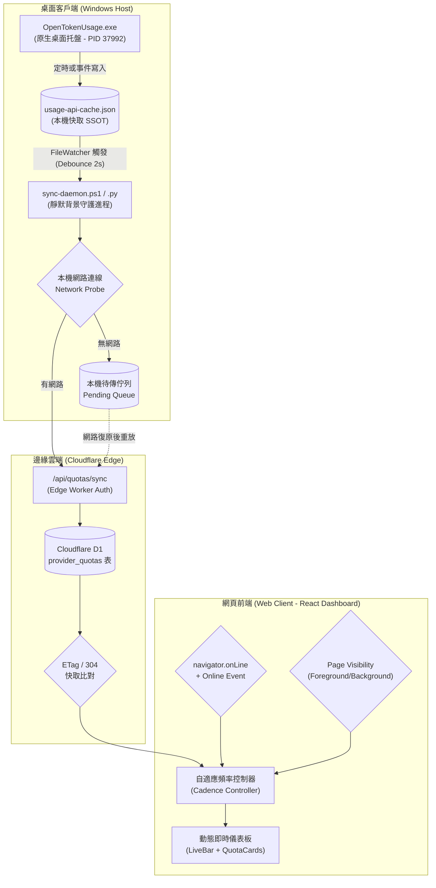
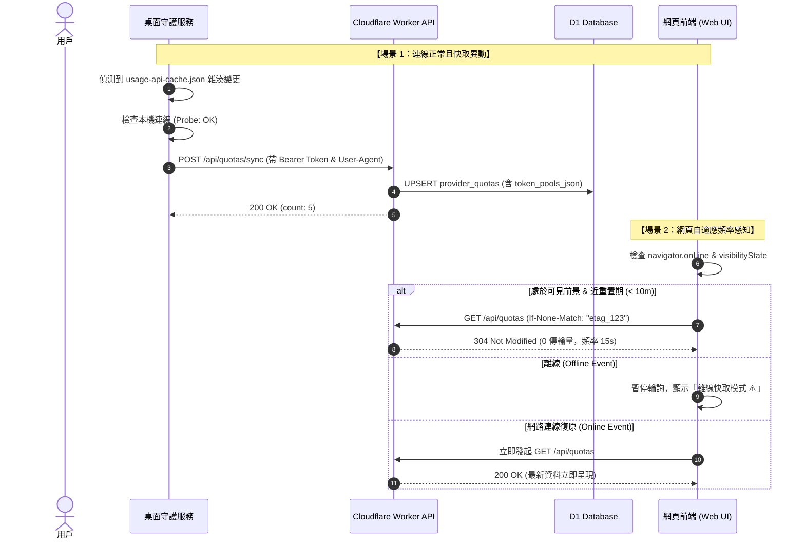

# 技術規格書 RFC：連線感知與自適應頻率資料同步架構 (Network-Aware & Adaptive Cadence Data Sync)

- **狀態**：RFC Draft (待審查)
- **領域**：前端 Web 儀表板、邊緣 Edge Worker、桌面端同步守護進程 (Sync Daemon)
- **相依規格**：[docs/rfc-multi-token-pools.md](file:///C:/Users/user/.gemini/antigravity/scratch/opentokenusage-web/docs/rfc-multi-token-pools.md)

---

## 1. 問題陳述與目標 (Problem Statement & Goals)

### 問題背景 (Problem Statement)
目前 OpenTokenUsage 儀表板存在兩大同步痛點：
1. **無效輪詢與盲目重試**：當使用者網路斷線、桌面睡眠或網路不穩時，若前端持續發起 HTTP 請求，將產生無意義的網路報錯、UI 卡頓並浪費頻寬；若桌面同步腳本在無網路時盲目推播，會導致例外中斷並消耗系統資源。
2. **缺乏更新頻率自適應性 (Lack of Cadence Adaptability)**：
   - 桌面端各 AI 平台的真實消耗與本機桌面快取（`usage-api-cache.json`）更新週期並不均勻（例如：OpenTokenUsage 桌面端預設約 15 分鐘抓取一次；使用者高強度編程時頻繁變動；重置時間點前後幾分鐘變化最劇烈）。
   - 若採取固定頻率強行定時輪詢，不是在資料未變動時產生過量冗餘請求（浪費 Cloudflare D1 讀寫配額），就是在重置倒數關鍵時刻反應延遲。
   - 使用者明確指示：「**只有網路有連線，根據資料更新頻率可以讓資料同步**」，要求系統具備連線感知（Online Detection）與自適應動態排程能力。

### 目標 (Goals)
1. **連線感知同步 (Network-Aware Sync)**：
   - **網頁端**：利用 `navigator.onLine` 與 `window.addEventListener('online'/'offline')`，斷網時立即掛起所有請求並展示「離線快取模式」徽章；連線復原瞬間立即觸發一次快速驗證同步。
   - **桌面端**：守護進程推送前先執行超輕量連線探針 (Probe DNS/HTTP 50ms check)，離線時將變更加入本機待傳佇列 (Pending Queue)，連線復原後批次送出。
2. **依資料頻率自適應同步 (Adaptive Cadence Scheduling)**：
   - **桌面異動驅動 (Change-Driven Event Push)**：桌面端以檔案監聽 (`FileSystemWatcher` / 雜湊比對 + 2s Debounce 防抖) 取代定時死輪詢，僅在快取內容實質變更時發起推送。
   - **智慧階梯輪詢 (Tiered Adaptive Polling)**：
     - *臨界/重置期 (Critical/Near-Reset)*：任一配額池剩餘 $\le 5\%$ 或距離重置時間 $< 10$ 分鐘，前端同步間隔提升為 **15 秒**。
     - *活躍編程期 (Active Working)*：網頁分頁處於可見前景（Page Visible），間隔維持 **30 秒**。
     - *平穩/閒置期 (Idle/Normal)*：配額充裕且無即將重置，間隔降為 **60~120 秒**。
     - *背景休眠期 (Background Tab)*：分頁隱藏時（`document.visibilityState === 'hidden'`）暫停高頻輪詢，切回時即時喚醒檢查。
3. **無痛全自動 (Zero-Touch Guarantee)**：用戶完全無需在桌面手動敲指令，開機即全自動監聽、斷網自動容錯、復網自愈補推。

### 非目標 (Non-goals)
- 不在 Cloudflare Worker 上儲存或代理使用者在各平台的原始帳號密碼（維持 Token 隱私安全，僅同步數值快照）。
- 不實作點對點 P2P 穿透（所有同步經由 Cloudflare Edge API 與 D1 安全資料庫）。

---

## 2. 系統架構與資料流 (System Architecture & Data Flow)



### 資料流互動時序 (Sequence Diagram)



---

## 3. 資料模型與介面契約 (Data Model & Interfaces)

### 3.1 頻率控制器狀態合約 (Cadence State Schema)

```typescript
export interface SyncCadenceConfig {
  mode: 'adaptive' | 'manual' | 'paused';
  currentIntervalMs: number;      // 當前輪詢間隔 (毫秒)
  isOnline: boolean;              // 瀏覽器是否連線
  isDocumentVisible: boolean;     // 視窗是否在前景
  governingState: 'critical' | 'near_reset' | 'active' | 'idle';
  lastSyncTimestamp: number;      // 最後成功同步時間戳
  pendingChangesCount: number;    // 待同步異動數
}
```

### 3.2 階梯頻率配置矩陣 (Cadence Rules)

| 狀態 (State) | 觸發條件 | 輪詢/推播頻率 | 頻寬策略 |
|---|---|---|---|
| **Offline** | `navigator.onLine === false` 或連線中斷 | **完全掛起 (0 req)** | 本機記憶體快取 + 離線提示標籤 |
| **Near-Reset / Critical** | 距任一池重置 $< 10$ 分鐘 或 剩餘 $\le 5\%$ | **15 秒** | 帶 ETag 輕量比對 (304 快速回應) |
| **Active Foreground** | 分頁可見 (`visible`) 且日常編程使用中 | **30 秒** | 帶 ETag 輕量比對 |
| **Idle / Stable** | 分頁可見，全配額充裕且無即將重置項目 | **60 秒** | 帶 ETag 輕量比對 |
| **Background Tab** | 分頁隱藏 (`hidden`) | **降頻至 300 秒** 或完全掛起 | 切回前景時立即（0秒）觸發單次同步 |

---

## 4. 安全、效能與發布策略 (Security, Performance & Rollout)

### 4.1 安全與防護 (Threat Model & Guardrails)
1. **SSRF 與 WAF 防護**：
   - 桌面推送必須顯式附帶自訂 User-Agent 標頭（`OpenTokenUsage-SyncDaemon/2.0`），避免被 Cloudflare 邊緣 WAF 擋截（已納入用戶全域規則守衛）。
   - 推送端點支援金鑰認證標頭 (`Authorization: Bearer <SYNC_KEY>`)。
2. **防重放與防碰撞 (Debounce & Idempotency)**：
   - 本機守護進程設置 2 秒防抖（Debounce Window），防止桌面軟體密集寫入快取時對 Edge 造成洪水攻擊。
   - D1 資料庫使用 `INSERT OR REPLACE INTO provider_quotas` 保持操作等冪性（Idempotency）。

### 4.2 效能與配額控制 (Performance & Quotas)
- **ETag / 304 最佳化**：當後端 D1 資料未實質改變時，Cloudflare Worker 直接回傳 `304 Not Modified`（0 payload），不消耗多餘網路傳輸量與前端 DOM 重新計算渲染。
- **背景節能**：Page Visibility API 確保用戶將網頁最小化或切換到其他工作分頁時，不會在背景無謂消耗 CPU 與網路資源。

---

## 5. 行為驗收與相容性矩陣 (Behavioral Acceptance & Compatibility)

| 使用情境／觸發 | 可觀察預期行為 | 錯誤／例外處理 | 應保留的既有行為 |
|---|---|---|---|
| **本機網路連線正常 + 桌面快取更新** | 2 秒內本機守護進程自動推送至 Edge，網頁於下個自適應週期（15~30s）即時更新顯示 | 推送失敗時重試 3 次，失敗後暫存佇列不崩潰 | 本機 `usage-api-cache.json` 本體檔案不受影響 |
| **本機網路斷線 (拔網路線/WiFi中斷)** | 桌面端偵測離線，暫停外部 HTTP 呼叫；網頁端切換為「離線快取模式」，停止無效 fetch | 嚴禁在 Console 拋出未處理的連線崩潰紅字 | 網頁保留斷線前最後已知快照，禁用即時按鈕 |
| **本機網路復原 (Reconnect)** | 桌面守護服務偵測復網，立即排空待傳佇列；網頁觸發 `online` 事件，立即刷新資料 | 若 Edge 端資料仍相同，接收 304 並維持綠燈 | 保留原選取的平台分頁與工作台展開狀態 |
| **配額即將重置 (< 10分鐘)** | 自適應控制器動態提頻至 15 秒，倒數條每秒遞減並精確在歸零時觸發重整 | 若 Edge 未更新，網頁端智慧到期推算自動滿血 (100%) | 不影響其他充裕平台的正常顯示 |
| **瀏覽器分頁切到背景 (Tab Hidden)** | 輪詢暫停或拉長為 300 秒，大幅降低本機與雲端能耗 | 切回分頁瞬間（0秒）立即執行一次靜默驗證刷新 | 視窗回到前景時立刻無縫呈現最新數據 |

---

## 6. 方案評估與取捨依據 (Options & Trade-offs)

### 方案 A：雙軌自適應頻率（推薦方案 - 本 RFC）
- **做法**：桌面以檔案異動事件為觸發源（零接觸開機守護）+ 網頁以連線狀態與配額急迫度進行自適應階梯輪詢。
- **優點**：兼顧即時性（有變更立馬推、近重置頻繁查）與低功耗（無網路零呼叫、無異動 304 零傳輸、背景休眠）。
- **缺點**：需在桌面端佈署一次開機註冊腳本（可程式化一鍵完成）。

### 方案 B：純雲端 WebSocket 長連線 (Durable Objects WebSockets)
- **做法**：桌面與網頁同時維持長連線至 Durable Object 進行發佈/訂閱廣播。
- **優點**：毫秒級極限即時。
- **缺點**：長連線需持續消耗連線保活 (Keep-alive)，斷網重連狀態機極為複雜，且在邊緣雲端會產生常態性連線費用，對於 15 分鐘更新一次的 Token 額度場景屬於過度設計 (Over-engineering)。

---

## 7. 交付產出物清單 (Deliverables)

1. **RFC 規格正本**：`brain/<conv-id>/rfc_adaptive_network_sync.md` 與專案 `docs/rfc-adaptive-network-sync.md`。
2. **本機自適應背景守護腳本**：
   - `scripts/sync-desktop-daemon.py`（支援 FileWatcher + Debounce + Network Probe）。
   - `scripts/install-sync-daemon.ps1`（Windows 開機自啟與排程註冊）。
3. **前端連線與自適應頻率控制器**：
   - `src/client/hooks/useAdaptiveSync.ts`（整合 `navigator.onLine`、`PageVisibility` 與動態週期階梯）。
4. **驗證與端到端測試**：
   - `tests/sync-cadence.spec.ts`（驗證離線掛起、復網立馬同步、階梯頻率切換）。
