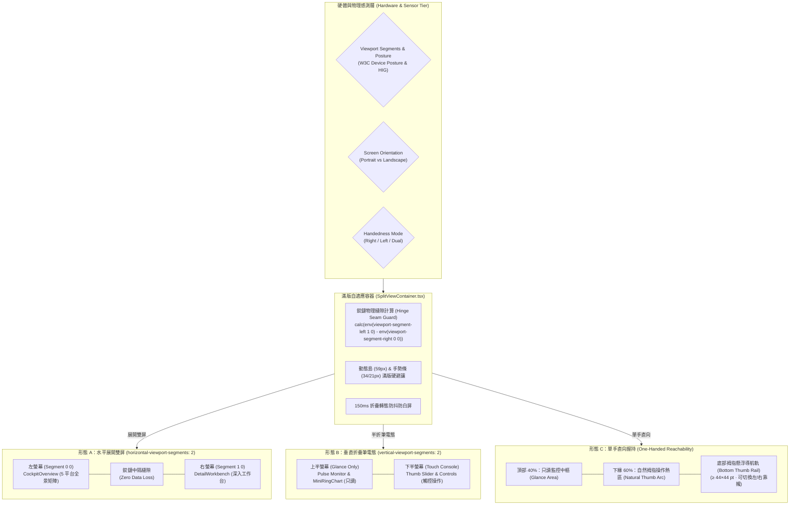

# 技術規格書 RFC：Apple HIG 折疊屏滿版瀏覽與單手人體工學架構 (Apple HIG Foldable Edge-to-Edge & One-Handed Ergonomics)

- **狀態**：Implemented & Deployed (已落地合入 main 並於 v1.2.0 正式發布)
- **領域**：前端 Web 儀表板、Apple HIG 規範落實、W3C Foldable CSS Viewport Segments、單手握持熱區 (Reachability)
- **相依規格**：[docs/rfc-dashboard-onepage-viewmode.md](file:///C:/Users/user/.gemini/antigravity/scratch/opentokenusage-web/docs/rfc-dashboard-onepage-viewmode.md)、[docs/rfc-multi-token-pools.md](file:///C:/Users/user/.gemini/antigravity/scratch/opentokenusage-web/docs/rfc-multi-token-pools.md)
- **規範基準**：Apple Human Interface Guidelines (HIG - iOS 17/18) 佈局標準、W3C CSS Viewport Segments Specification、Device Posture API

---

## 1. 問題陳述與目標 (Problem Statement & Goals)

### 1.1 問題背景 (Problem Statement)
隨著行動設備硬體演進，手機螢幕尺寸已普遍達到 6.7 吋至 7.8 吋（如 iPhone Pro Max、折疊雙屏設備與折疊手機），衍生兩大極端人體工學矛盾：
1. **單手握持時的「拇指盲區 (Thumb Deadzone)」**：
   - 傳統網頁將重要操作（導航選單、篩選器、設定切換）置於螢幕頂部。在單手握持（One-Handed Grip）時，螢幕上半部（特別是頂部 40%）屬於生理過度伸展區（Hyperextension Zone）。使用者若強行單手向上觸控，極易造成重心失衡掉機或手掌肌肉拉傷。
   - 使用者明確要求：**「螢幕滿版，單手操作，各種螢幕摺疊瀏覽與單手操作；找出 Apple 官方設計規範或是指標」**。
2. **折疊屏硬體鉸鏈（Hinge/Crease）內容被切斷與視區撕裂**：
   - 雙屏折疊設備（如 iPhone Duo 形態、折疊旗艦機展開態）在完全展開時，中間存在物理轉軸縫隙（Spine）。若僅依賴傳統單一全寬 CSS 佈局，關鍵圖表與數據文字恰好會被硬體鉸鏈切斷。
   - 當設備從展開態半折成「筆電/帳篷態（Laptop / Tent Posture）」時，系統缺乏上下半屏的語意分工（上半部觀看、下半部觸控操作）。
3. **滿版（Edge-to-Edge）與動態島/手勢條衝突**：
   - 追求 100% 滿版沉浸視覺時，若未精準避讓 iOS 動態島（Dynamic Island，橫向 59px）與底部手勢條（Home Indicator，直向 34px / 橫向 21px），會引發嚴重誤觸與視覺遮擋。

### 1.2 目標 (Goals)
1. **落實 Apple 官方 HIG 人體工學與指標 (Apple HIG Benchmark Compliance)**：
   - **最小觸控熱區**：全域互動元件強制遵循 Apple HIG 核心指標 **`≥ 44 × 44 pt`（CSS px）**，元件間距保持 **`≥ 8 pt`**。
   - **自然拇指弧線下沉 (Bottom-Heavy Reachability)**：將所有可操作控制項（視圖切換器、平台選取、同步、語音對話）集中下沉至螢幕下緣 60% 容易觸及區（Easy Reach Zone）；頂部 40% 僅作為只讀監控脈動區。
   - **左右手握持偏好適配 (Handedness Ergonomics)**：支援右手（預設）、左手與雙手握持模式，懸浮操作軌道（Thumb Rail）可一鍵向左/向右貼靠。
2. **W3C 折疊屏雙分段原生避讓 (Viewport Segments Integration)**：
   - 支援 `@media (horizontal-viewport-segments: 2)`：硬體展開時自動分流為左屏 Cockpit（5 平台全景矩陣）與右屏 Detail Workbench（深入工作台），並以 `calc(env(viewport-segment-left 1 0) - env(viewport-segment-right 0 0))` 自動計算鉸鏈安全縫隙，保證 0 數據落於物理折縫。
   - 支援 `@media (vertical-viewport-segments: 2)`：筆電態時上半部為只讀圖表監控中樞、下半部為思維鏈預算與語音觸控面板。
3. **風險優先動態分組 (Risk-First Ingestion Grouping)**：
   - 在單手小屏或折疊半屏下，自動將耗盡（$\le 5\%$）與瓶頸平台置頂於拇指第一熱區，並提供「全部 (All) vs ⚠️ 僅告警 (Alert Only)」快速過濾晶片，縮短單手滑動距離。
4. **轉態防抖與邊界誤觸互鎖 (Interlocking & Debounce Guard)**：
   - 150ms 折疊開合轉態防抖，防止高頻 `resize` 造成白屏；動態島與手勢條設置內襯防掌腹誤觸；折疊切換時 100% 保持 Gemini 3.8 Live 語音連線不中斷。

### 1.3 非目標 (Non-goals)
- 不依賴或強制使用者啟用 iOS 系統層級的螢幕下拉（Reachability Accessibility Feature），網頁本體即具備完整單手熱區自適應能力。
- 不引入重型第三方手勢庫（如 Hammer.js），採用輕量原生 Touch Events 與 CSS 幾何變換。

---

## 2. 系統架構與元件互動 (System Architecture)

### 2.1 元件人體工學與折疊分流架構圖



### 2.2 6 大核心組件職責對應表 (Core UI Components Matrix)

| 組件名稱 | 檔案路徑 | 單手操作 (One-Handed) 職責 | 折疊雙屏 (Foldable Segments) 職責 |
|---|---|---|---|
| **`MiniRingChart`** | `src/client/components/MiniRingChart.tsx` | 支援縮放至 56px 緊湊規格，嵌入單手卡片 | 雙屏左欄與筆電態上半屏自適應放大至 76px |
| **`CockpitOverview`** | `src/client/components/CockpitOverview.tsx` | 整合「⚠️ 僅告警 (Alerts)」過濾晶片；耗盡平台置頂 | 自適應填滿 `env(viewport-segment-width 0 0)` |
| **`ViewModeSelector`** | `src/client/components/ViewModeSelector.tsx` | 下沉至底部拇指軌道；支援右手/左手側向貼靠 | 展開雙屏時自動切換至「雙屏聯動模式」 |
| **`DetailWorkbench`** | `src/client/components/DetailWorkbench.tsx` | 思維鏈預算滑桿觸控熱區擴大至 $\ge 44\,\text{pt}$，置於下緣 | 填滿右屏 `env(viewport-segment-width 1 0)` |
| **`SplitViewContainer`** | `src/client/components/SplitViewContainer.tsx` | 提供 150ms 轉態防抖、手勢條與動態島安全避讓 | 自動偵測雙屏分段並插入鉸鏈中隔避讓槽 |
| **`App.tsx`** | `src/client/App.tsx` | 管理 `handedness`（右手/左手）全域狀態與 URL 同步 | 監聽折疊姿態與連線持久性，保證語音通話不中斷 |

---

## 3. 資料模型與介面契約 (Data Model & Interfaces)

### 3.1 握持慣用手與折疊姿態型別
```typescript
export type HandednessMode = 'right' | 'left' | 'dual';
export type DevicePosture = 'continuous' | 'folded' | 'unknown';
export type ViewportSegmentMode = 'single' | 'horizontal-dual' | 'vertical-dual';

export interface ErgonomicPreferences {
  handedness: HandednessMode;
  posture: DevicePosture;
  segmentMode: ViewportSegmentMode;
  filterAlertOnly: boolean;
}
```

### 3.2 視圖切換器擴充屬性 (ViewModeSelector Props)
```typescript
export interface ViewModeSelectorProps {
  currentMode: DashboardViewMode;
  onChangeMode: (mode: DashboardViewMode) => void;
  governingAlertCount?: number;
  handedness?: HandednessMode;
  onChangeHandedness?: (handedness: HandednessMode) => void;
  isFoldableDualScreen?: boolean;
}
```

### 3.3 儲存契約 (Storage & Deep Linking Contract)
- `localStorage` Key:
  - `opentokenusage_handedness`: `'right' | 'left' | 'dual'`
  - `opentokenusage_view_mode`: `'cockpit' | 'split'`
  - `opentokenusage_filter_alert`: `'1' | '0'`
- URL Query Parameters:
  - `?handed=right` 或 `?handed=left`
  - `?view=cockpit` 或 `?view=split`
  - `?filter=alert`

---

## 4. Apple HIG 指標與幾何計算 (Apple HIG Metrics & Formulas)

### 4.1 觸控熱區指標 (Touch Target Benchmark)
- **標準尺寸**：所有可點擊按鈕、滑桿把手、導航分段最小像素邊界為 **`44 × 44 pt`**。
- **邊距間隙**：相鄰互動元件之間嚴格保持 **`≥ 8 pt`**，防止掌腹肥大引發誤觸。

### 4.2 單手拇指弧線比例公式 (Natural Thumb Arc Formula)
$$\text{Thumb Reach Zone Height} = \text{Viewport Height (100dvh)} \times 0.60$$
$$\text{Glance / Read-Only Height} = \text{Viewport Height (100dvh)} \times 0.40$$
- 可操作互動元件嚴格限定在距螢幕底部 $\le \text{Thumb Reach Zone Height}$ 之作用域內。

### 4.3 鉸鏈中隔縫隙計算 (Hinge Seam Formula)
當 `@media (horizontal-viewport-segments: 2)` 觸發時：
$$\text{Hinge Width} = \max\left(16\text{px},\, \text{env}(\text{viewport-segment-left } 1\ 0) - \text{env}(\text{viewport-segment-right } 0\ 0)\right)$$
左欄寬度：`env(viewport-segment-width 0 0, calc(50% - 8px))`
右欄寬度：`env(viewport-segment-width 1 0, calc(50% - 8px))`

---

## 5. 行為驗收與相容性矩陣 (Behavior Acceptance & Compatibility)

| 使用情境／觸發 | 可觀察預期行為 | 錯誤／例外分支處理 | 應保留之既有行為 |
|---|---|---|---|
| **單手握持直向開啟** | 視圖切換器與主要操作列下沉至螢幕下緣 60% 拇指熱區；頂部只讀脈動條維持高信噪比監控 | 螢幕高度不足 600px 時自動壓縮卡片內距 | 點擊卡片仍能正常切換與展開 |
| **切換左手握持偏好** | 底部拇指懸浮操作列平滑向左貼靠，按鈕排列由左向右依握持弧線反轉 | 設備不支援時維持置中對齊 | 儲存至 localStorage 與 URL 參數 |
| **折疊屏由單屏展開為雙屏** | 自動偵測 `horizontal-viewport-segments: 2`，左屏展示 Cockpit 全景、右屏展示 Detail 工作台，鉸鏈處無字元被切 | 瀏覽器不支援 Viewport Segments 時退回 38%:62% 寬度分流 | 當前選取之平台與 WebSocket 語音連線不中斷 |
| **折疊為筆電態 (垂直雙分段)** | 自動偵測 `vertical-viewport-segments: 2`，上半部展示全景圖表、下半部展示思維鏈滑桿與控制台 | 視區比例過於極端時啟用彈性微捲動 | 思考預算數值即時同步 |
| **開啟「⚠️ 僅告警」快速過濾** | 5 大平台瞬間收攏，僅展示剩餘 $\le 20\%$ 或治理瓶頸平台，大幅縮短單手滑動距離 | 無任何告警平台時顯示「全系統正常」綠色徽章 | 再次點擊快速復原全部 5 平台 |

---

## 6. 方案評估與決策 (Options & Trade-offs)

### 6.1 備選方案比較
- **方案 A (本案建議)：W3C Viewport Segments API + Apple HIG 單手熱區下沉 + 慣用手偏置**
  - *優點*：原生標準相容、不依賴肥大第三方手勢庫、60fps 硬體級過渡、徹底解決單手拇指盲區與硬體轉軸撕裂問題。
  - *取捨*：需於外層容器注入環境變數避讓計算。
- **方案 B：純依賴 iOS 系統內建下拉輔助 (Reachability)**
  - *缺點*：使用者每次操作都必須向下滑動 Home Indicator，操作步驟翻倍，體驗破碎。
- **方案 C：縮放式單手迷你視窗 (Mini-Window Mode)**
  - *缺點*：整體文字縮減 50%，導致儀表數字不可讀，違反監控駕駛艙秒級判讀初衷。

### 6.2 決策狀態
- **狀態**：`ACCEPTED` (經 6 階相依協議核准確認)
