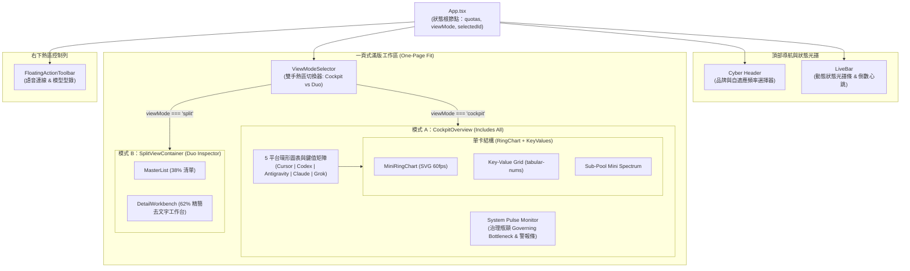
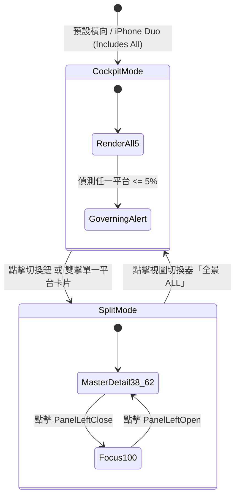

# 技術規格書 RFC：一頁式極簡監控儀表板與 iPhone Duo 全覽視圖模式架構 (One-Page High-Density Cockpit & iPhone Duo ViewMode)

- **狀態**：RFC Draft (待審查)
- **領域**：前端 Web 儀表板、視覺資料流、Apple HIG 行動人體工學、多平台額度監控
- **相依規格**：[docs/rfc-multi-token-pools.md](file:///C:/Users/user/.gemini/antigravity/scratch/opentokenusage-web/docs/rfc-multi-token-pools.md)、[docs/rfc-adaptive-network-sync.md](file:///C:/Users/user/.gemini/antigravity/scratch/opentokenusage-web/docs/rfc-adaptive-network-sync.md)

---

## 1. 問題陳述與目標 (Problem Statement & Goals)

### 1.1 問題背景 (Problem Statement)
目前 OpenTokenUsage Web 儀表板在實際日常多工巡檢時存在三大核心痛點：
1. **視圖割裂，缺乏「全景一覽 (All-in-One)」監控能見度**：
   - 原有佈局為傳統 Master-Detail 結構（左側清單 38%、右側工作台 62%）。右側工作台一次僅能展示「單一平台（選取的項目）」的深入資訊。
   - 工程師在評估跨平台額度（例如 Cursor 耗盡後應立即切換至 Codex 還是 Google Antigravity）時，必須反覆點選左側 5 個項目逐一查看，缺乏宏觀的全局監控駕駛艙。
2. **文字冗贅（Wordy），視覺信噪比低**：
   - 舊版 Detail 工作台包含大量通識性說明文字（如思維鏈預算說明、語音助手使用說明、空狀態文字教學），佔據寶貴的螢幕空間。
   - 監控儀表板的核心價值在於**「秒級狀態感知」**，過多文字干擾關鍵數據判定，使用者明確要求「**no much wording , chart , key value , monitor be major**」。
3. **未能滿足「一頁自適應（One-Page Fit）」與 iPhone Duo 雙手觸控體驗**：
   - 舊版在手機橫向（Landscape）或折疊屏（iPhone Duo 模式）下，垂直高度易產生多重滾動條，無法在一屏之內（View Fit）完整呈現。
   - 缺乏專屬的視圖模式切換（ViewMode Toggle），使用者無法一鍵切換「全景矩陣駕駛艙（All Cockpit）」與「雙欄深入工作台（Duo Split）」。

### 1.2 目標 (Goals)
1. **極度去文字化 (Ruthless Fluff Removal)**：
   - 全面移除通識段落、教學性長文本與冗餘標籤，代之以高對比視覺符號、狀態指示燈、語意微徽章（`MUTED`/`ALERT`）與指標數值。
2. **圖表化與鍵值對為核心 (Charts & Key-Values as Major)**：
   - **SVG 環形儀表盤 (Radial Ring Gauge)**：為每大平台實作輕量化、零外部依賴的 SVG 環形圖表，直觀呈現有效剩餘與耗盡警示。
   - **高密度 Key-Value 矩陣**：嚴格使用 `tabular-nums` 與等寬字型，集中呈現 `REMAINING`、`USED`、`RESET TIME`、`BOTTLENECK`、`TIER 1 (5h)`、`TIER 2 (Weekly)` 等關鍵指標。
   - **即時脈動中樞 (System Pulse Monitor)**：突出治理瓶頸（Governing Bottleneck），全自動捕捉跨 5 大平台中最嚴格之限額池並即時示警。
3. **一頁式自適應視圖 (One-Page Fit)**：
   - 採用 `h-full` / `100dvh` 滿版視區幾何佈局，消除頁面級多餘滾動，達成「開屏即全覽」的極致密度。
4. **iPhone Duo 專屬最佳視圖切換 (iPhone Duo ViewMode)**：
   - 實作雙重視圖模式（ViewMode）：
     - **全景矩陣駕駛艙 (`cockpit`)**：一屏納入全部 5 大平台（Includes All），以 5 格高密度圖表+鍵值矩陣並排呈現。
     - **雙欄檢驗台 (`split`)**：Apple HIG 38%:62% 黃金分割，支援單一平台配額池深度調整。
   - **雙手拇指人體工學 (Two-Handed Thumb Zone)**：
     - 左手熱區：視圖切換膠囊（`ALL` vs `DUO`）、快速過濾晶片。
     - 右手熱區：即時加速更新鈕、全域語音鈕、全螢幕切換鈕，觸控尺寸均 $\ge 44 \times 44\,\text{pt}$。
   - **物理避讓**：完整適配動態島 59px 安全邊距（`safe-area-inset-left/right`）。

### 1.3 非目標 (Non-goals)
- 不引入龐大第三方圖表函式庫（如 Chart.js, ECharts 或 Recharts），維持 Cloudflare 邊緣與 Vite 建置極速與輕量性（零額外 runtime 負擔）。
- 不變更現有後端 API 與 D1 資料庫結構（相容現有 `/api/quotas` 與 Token Pools 契約）。

---

## 2. 系統架構與元件互動 (System Architecture)

### 2.1 元件架構圖 (Component Architecture)



### 2.2 視圖模式轉換狀態機 (ViewMode State Transitions)



---

## 3. 資料模型與介面契約 (Data Model & Interfaces)

### 3.1 視圖模式型別定義 (ViewMode Types)
```typescript
export type DashboardViewMode = 'cockpit' | 'split';

export interface ViewModeSelectorProps {
  currentMode: DashboardViewMode;
  onChangeMode: (mode: DashboardViewMode) => void;
  governingAlertCount: number;
}
```

### 3.2 輕量化環形圖表屬性 (MiniRingChart Props)
```typescript
export interface MiniRingChartProps {
  value: number; // 剩餘百分比 (0-100)
  size?: number; // 像素尺寸 (預設 64)
  strokeWidth?: number; // 圓環厚度 (預設 6)
  gradientId: string;
  gradientColors: [string, string];
  isCritical?: boolean;
  label?: string;
}
```

### 3.3 全景平台卡鍵值資料結構 (Cockpit Platform KV)
```typescript
export interface CockpitPlatformMetric {
  id: string;
  name: string;
  planName: string;
  remainingPercent: number;
  usedQuota: number;
  resetTimeText: string;
  isCritical: boolean;
  isWarning: boolean;
  governingPoolName?: string;
  subPools: Array<{
    name: string;
    remaining: number;
    isCritical: boolean;
  }>;
}
```

---

## 4. 安全、效能與人體工學 (Safety, Performance & HIG)

### 4.1 空間幾何與一頁適配 (Viewport Fit Geometry)
- 頂部導航列高度：`48px`。
- LiveBar 狀態光譜條高度：`38px`。
- 剩餘有效主視區高度：`calc(100dvh - 86px)`。
- iPhone Duo 橫向典型尺寸：寬度 $844 \sim 932\,\text{px}$，高度 $390 \sim 430\,\text{px}$。
- 主面板採用 `grid-cols-2 lg:grid-cols-5` 或緊湊 5 欄流式佈局，卡片垂直高度限制在 $140 \sim 180\,\text{px}$ 區間，確保無縱向溢出、無需滑動即可一屏綜覽。

### 4.2 iPhone Duo 雙手握持人體工學 (Two-Handed Thumb Zone)
```
+-------------------------------------------------------------------+
|  [Header] OpenTokenUsage                  [15s/30s/60s] [Online]  |
|  [LiveBar] Pulse Spectrum (Cursor Codex Antigravity Claude Grok)  |
+-------------------------------------------------------------------+
|  LEFT THUMB ZONE              CENTER MONITOR     RIGHT THUMB ZONE |
|  +------------------------+  +---------------+  +---------------+ |
|  | [ALL] (Duo)            |  | Governing:    |  | [Sync Now]    | |
|  | Cockpit View Mode      |  | Argon (0%)    |  |               | |
|  +------------------------+  +---------------+  +---------------+ |
|                                                                   |
|  [ 5-PLATFORM HIGH-DENSITY CHARTS & KEY-VALUES MATRIX ]           |
|  +--------+ +--------+ +--------+ +--------+ +--------+           |
|  | Cursor | | Codex  | | AGY    | | Claude | | Grok   |           |
|  |  ( )   | |  ( )   | |  ( )   | |  ( )   | |  ( )   |           |
|  |  0%    | |  0%    | |  31%   | |  2%    | |  0%    |           |
|  +--------+ +--------+ +--------+ +--------+ +--------+           |
|                                                  [MIC Live] (R)   |
+-------------------------------------------------------------------+
```

### 4.3 渲染效能 (60fps Guarantee)
- 原生 SVG 環形圖表透過 `stroke-dashoffset` 搭配 CSS `transition: stroke-dashoffset 0.6s cubic-bezier(0.16, 1, 0.3, 1)`，無重繪開銷，極限省電。
- 嚴格維持 `tabular-nums`，數字跳動不造成版面震顫（Zero Layout Shift）。

---

## 5. 行為驗收與相容性矩陣 (Behavior Acceptance & Compatibility)

| 使用情境／觸發 | 可觀察預期行為 | 錯誤／例外分支處理 | 應保留之既有行為 |
|---|---|---|---|
| 頁面載入 (預設橫向 / iPhone Duo) | 預設呈現「全景 Cockpit 模式」，同時展示全部 5 大平台之環形圖表、有效剩餘與重置鍵值 | 離線時自動展示離線快取數據，並套用滿血自動推算 | URL 深度連結 `?view=cockpit&duo=1` 支援狀態還原 |
| 點擊視圖切換器切換至「Duo Split」 | 視圖平滑無白屏轉換為 38%:62% 雙欄檢驗台，保留選取之項目高亮 | 若螢幕旋轉至直向 (<640px)，自動回退為單欄卡片流 | 雙欄模式下支援側欄收合 (Focus Mode) |
| 雙擊 Cockpit 任一平台卡片 | 立即自動聚焦該平台並切換為 Duo Split 模式，方便深入調整預算 | 點選無效區域不觸發跳轉 | 平台專屬主題炫彩光暈保持一致 |
| 任一平台配額池耗盡 ($\le 5\%$) | 頂部 Pulse Monitor 立即亮起紅色警報徽章，環形圖與鍵值變紅並脈動 | 多池同時告警時，以最嚴格瓶頸優先置頂呈現 | 絕不因單一配額耗盡中斷其他平台之監控 |
| 點擊語音按鈕或重新整理 | 懸浮操作列維持在右下角熱區，點擊觸發震動反饋 (Haptic) 與相應動作 | 瀏覽器不支援震動時安靜降級 | WebSocket Live 連線不因視圖切換而中斷 |

---

## 6. 方案評估與取捨 (Options & Trade-offs)

### 6.1 備選方案比較
- **方案 A (本案建議)：原生輕量 SVG 環形圖表 + 雙重視圖模式 (Cockpit / Duo Split)**
  - *優勢*：零外部依賴、打包體積增加 $< 5\,\text{KB}$、60fps 順暢渲染、兼顧宏觀「全景一覽」與微觀「雙欄調校」、完全符合 iPhone Duo 橫向一頁適配。
  - *取捨*：需微調現有容器外層以支援視圖切換狀態。
- **方案 B：僅在現有 DetailWorkbench 增加長表格，不提供全景視圖**
  - *缺點*：使用者在橫向設備上仍無法同時看見全部 5 大平台，依然需要頻繁切換清單，違反「includes all」與「one page design (fit)」的核心訴求。
- **方案 C：引入第三方圖表庫 (如 Chart.js / Recharts)**
  - *缺點*：增加超過 $200\,\text{KB}$ 打包體積，iOS Safari 橫向容易出現 Canvas 模糊與縮放重繪問題，違反輕量邊緣原則。

### 6.2 決策狀態
- **狀態**：`PROPOSED` (待用戶審查核准)
- **開放決策 (Open Decisions)**：
  1. 是否在直向螢幕（Portrait，寬度 < 640px）下亦預設提供 Cockpit 模式切換鈕，抑或鎖定於橫向/平板模式？（建議：提供雙向切換，直向時 Cockpit 自動折疊為雙欄網格）。
