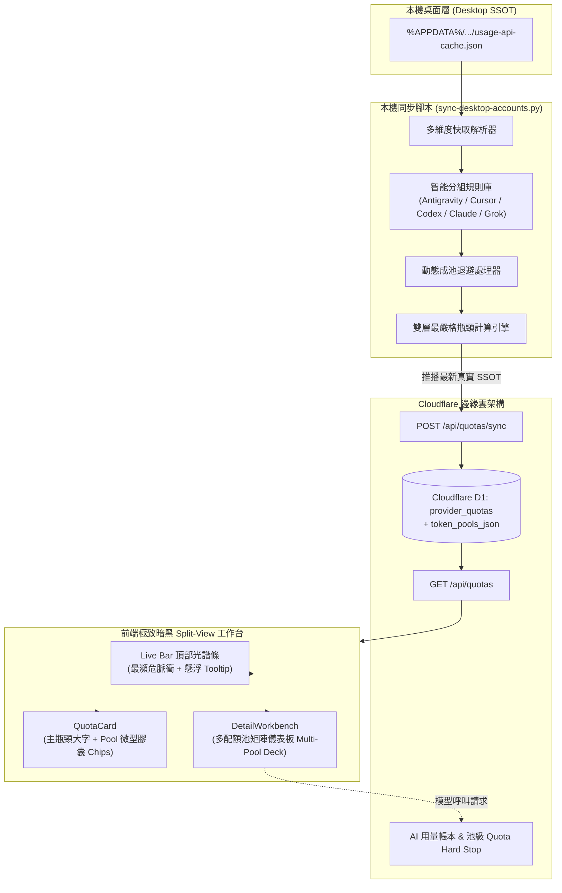

# RFC-003：支援平台多配額池 (Multi-Token Pools) 與階層式雙層瓶頸架構規格書

- **狀態**：Implemented & Deployed (已落地合入 main 正式發布)

本規格書依據前次工作階段 [[45d77b32](conversation://45d77b32-65e4-44f0-bbdc-906cd61f9dc5)] 之根因定位、用戶提供之 Google Antigravity 實機截圖，以及本次 `/grill-me` 深度架構訪談決策，制定 OpenTokenUsage 全端系統支援「多配額池 (Multi-Token Pools)」之技術藍圖與架構決策。

---

## 1. 問題描述與目標 (Problem Statement & Goals)

### 1.1 問題描述 (Problem Statement)
1. **單一配額抽象失真**：現行資料模型假設一個 AI 平台只有一個主配額（`used_quota`, `remaining_percent`），無法描述現代 AI 桌面 Agent（如 Google Antigravity）內部多模型家族各自獨立的配額池。
2. **多週期瓶頸錯置**：單一配額池內部往往存在多個時間滑動視窗（如 5 小時短期會話 vs 7 天長期週度限額）。若未進行瓶頸比對，容易產生虛假的健康度呈現。
3. **單點耗盡擴散性盲區**：在現有 UI 中，若 Antigravity 的某個子模型池（例如 Argon）耗盡，用戶在主卡片完全看不出異常，直到呼叫該模型被拒絕才發現阻斷。

### 1.2 核心目標 (Goals)
1. **三層資訊階層架構 (IA)**：
   $$\text{Platform (平台)} \longrightarrow \text{Token Pools (配額池)} \longrightarrow \text{Quota Tiers (時間週期)}$$
2. **雙層最嚴格瓶頸演算法 (Two-Tier Governing Bottleneck)**：
   - **Pool 層**：$\text{Remaining}_{\text{pool}} = \min(\text{Remaining}_{\text{tier}_1}, \text{Remaining}_{\text{tier}_2}, \dots)$
   - **平台層**：$\text{Remaining}_{\text{platform}} = \min(\text{Remaining}_{\text{pool}_1}, \text{Remaining}_{\text{pool}_2}, \dots)$
   - 平台主卡片主數值與警示狀態強制綁定全平台最瀕危池（如 Argon 0% 即時亮紅燈）。
3. **100% 向下相容之 D1 儲存方案**：
   - 在 D1 `provider_quotas` 新增結構化 `token_pools_json` 欄位。
   - 保留既有純量欄位，相容既有 MCP 工具、舊版 API 消費者與 Live Bar。
4. **極致暗黑霓虹 UI 全面升級**：
   - **QuotaCard**：維持簡約主卡片，新增微型膠囊標籤（Mini-Chips）並列呈現各 Pool 水位。
   - **DetailWorkbench**：打造「多配額池矩陣儀表板 (Multi-Pool Deck)」，提供獨立高保真進度條與雙週期重置倒數。
   - **Live Bar**：頂部 Antigravity 分段以最瀕危池觸發脈衝告警，懸浮 Tooltip 展開全 Pools 清單。
5. **池級粒度配額硬阻斷 (Pool-Level Hard Stop)**：
   - 用量帳本阻斷機制精確到 Model Pool 級別，Argon 耗盡時僅阻斷 Argon，額度充裕的 Gemini/Claude 模型持續放行。

### 1.3 非目標 (Non-goals)
- 不主動修改本機快取 `%APPDATA%\com.poweruserz.opentokenusage\usage-api-cache.json`（維持唯讀擷取）。
- 不替換現有 5 大平台之主導航架構（不將每個 Pool 拆散為獨立卡片，避免 Master List 臃腫失焦）。

---

## 2. 系統架構與資料流 (System Architecture & Data Flow)



---

## 3. 資料模型與介面契約 (Data Model & Interfaces)

### 3.1 TypeScript 領域模型定義 (`src/types/quota.ts`)

```typescript
export interface QuotaTier {
  id: string;                      // 例如 "5h", "weekly"
  label: string;                   // 顯示標籤，例如 "5h limit", "Weekly limit"
  used: number;                    // 已使用百分比 (0~100)
  limit: number;                   // 限制基準 (通常為 100)
  remaining: number;               // 剩餘百分比 (100 - used)
  resetsAt: string | null;         // ISO 8601 重置時間戳
  resetDurationText?: string;      // 友善倒數，例如 "4h 37m", "2d 9h"
  isGoverning?: boolean;           // 是否為該 Pool 內之最嚴格瓶頸週期
}

export interface TokenPool {
  id: string;                      // 唯一標識，例如 "gemini_models", "claude_gpt", "gemini_4_argon"
  name: string;                    // 顯示名稱，例如 "Gemini Models"
  description?: string;            // 描述或所屬模型列表
  effectiveRemaining: number;      // 該 Pool 之有效剩餘百分比 = min(tiers.remaining)
  effectiveUsed: number;           // 該 Pool 之有效用量 = 100 - effectiveRemaining
  primaryResetTime: string | null; // 最緊迫之重置時間
  isCritical: boolean;             // 是否處於危急/耗盡狀態 (effectiveRemaining <= 5)
  tiers: QuotaTier[];              // 該 Pool 所屬的時間週期階層清單
}

export interface ProviderQuota {
  provider_id: string;             // "cursor" | "codex" | "antigravity" | "claude" | "grok"
  name: string;                    // "Google Antigravity"
  plan_name: string;               // "Google AI Pro"
  total_quota: number;             // 100
  used_quota: number;              // 平台全域最嚴格用量 (例如 100)
  remaining_percent: number;       // 平台全域最嚴格剩餘 (例如 0)
  reset_time: string;              // 平台全域最嚴格重置時間
  status: string;                  // "active" | "exhausted" | "warning"
  token_pools_json?: string;       // JSON 序列化之 TokenPool[]
  token_pools?: TokenPool[];       // 前端解析後之結構化物件陣列
  metrics_json?: string;           // 既有舊版指標 (相容性保留)
  fetched_at: string;
}
```

### 3.2 Cloudflare D1 資料庫遷移指令碼 (`migrations/0003_add_token_pools_json.sql`)

```sql
-- Cloudflare D1 Migration 0003: Multi-Token Pools Schema Evolution
ALTER TABLE provider_quotas ADD COLUMN token_pools_json TEXT;

UPDATE provider_quotas 
SET 
    token_pools_json = json_array(
        json_object(
            'id', 'gemini_models',
            'name', 'Gemini Models',
            'effectiveRemaining', 31.0,
            'effectiveUsed', 69.0,
            'primaryResetTime', '2026-11-02T16:54:00Z',
            'isCritical', false,
            'tiers', json_array(
                json_object('id', 'weekly', 'label', 'Weekly limit', 'used', 69.0, 'limit', 100.0, 'remaining', 31.0, 'resetsAt', '2026-11-02T16:54:00Z', 'resetDurationText', '2d 9h', 'isGoverning', true),
                json_object('id', '5h', 'label', '5h limit', 'used', 5.0, 'limit', 100.0, 'remaining', 95.0, 'resetsAt', '2026-10-31T12:31:00Z', 'resetDurationText', '4h 37m', 'isGoverning', false)
            )
        ),
        json_object(
            'id', 'claude_gpt',
            'name', 'Claude and GPT models',
            'effectiveRemaining', 46.0,
            'effectiveUsed', 54.0,
            'primaryResetTime', '2026-11-02T16:54:00Z',
            'isCritical', false,
            'tiers', json_array(
                json_object('id', 'weekly', 'label', 'Weekly limit', 'used', 54.0, 'limit', 100.0, 'remaining', 46.0, 'resetsAt', '2026-11-02T16:54:00Z', 'resetDurationText', '2d 9h', 'isGoverning', true),
                json_object('id', '5h', 'label', '5h limit', 'used', 0.0, 'limit', 100.0, 'remaining', 100.0, 'resetsAt', null, 'resetDurationText', '充足', 'isGoverning', false)
            )
        ),
        json_object(
            'id', 'gemini_4_argon',
            'name', 'Gemini 4 Argon',
            'effectiveRemaining', 0.0,
            'effectiveUsed', 100.0,
            'primaryResetTime', '2026-11-02T15:54:00Z',
            'isCritical', true,
            'tiers', json_array(
                json_object('id', 'weekly', 'label', 'Weekly limit', 'used', 100.0, 'limit', 100.0, 'remaining', 0.0, 'resetsAt', '2026-11-02T15:54:00Z', 'resetDurationText', '2d 8h', 'isGoverning', true)
            )
        )
    ),
    used_quota = 100.0,
    remaining_percent = 0.0,
    reset_time = '2026-11-02T15:54:00Z',
    status = 'active',
    updated_at = CURRENT_TIMESTAMP
WHERE provider_id = 'antigravity';
```

---

## 4. UI 視覺與互動元件規格 (UI Component Specifications)

1. **Master List 卡片微型膠囊標籤 (`QuotaCard.tsx`)**：
   - 主數值顯示全平台最嚴格瓶頸（0% 剩餘，紅色脈衝邊框）。
   - 卡片中央並排 Mini-Chips 膠囊：`Gemini: 31%` · `Claude/GPT: 46%` · `Argon: 0% ⚠️`。
2. **Detail 工作台多配額池矩陣儀表板 (`DetailWorkbench.tsx`)**：
   - 專屬 `Multi-Pool Matrix Deck` 區塊，3 張獨立高保真卡片。
   - 各池支援 5h vs Weekly 雙週期獨立進度條與重置倒數。
3. **頂部 Live Bar 與懸浮 Tooltip (`LiveBar.tsx`)**：
   - Antigravity 分段以最瀕危池觸發脈衝告警。
   - Hover 懸浮 Tooltip 展開全 Pools 清單。

---

## 5. 行為驗收與測試矩陣 (Acceptance Criteria & Test Matrix)

| 使用情境／觸發 | 可觀察預期 (Pass Criteria) | 錯誤／例外分支 | 應保留的既有行為 |
|---|---|---|---|
| **本機快照包含多個模型池 (如 Antigravity)** | 1. 成功解析為 3 個獨立 Token Pool。<br>2. 平台主卡片與 Live Bar 顯示 0% 剩餘（最嚴格瓶頸）。<br>3. Detail 工作台完整渲染 3 張配額池矩陣卡片。 | 快照缺少某池的 5h 週期時，該池自動降級為單一 Weekly 週期，不報錯崩潰。 | 舊版單一配額平台（如單純 Grok）仍以單一 Pool 正常呈現。 |
| **遇到未定義之新模型池標籤** | 自動以動態成池退避器建立新型 Token Pool 實體，名稱直接沿用標籤名，100% 呈現在介面上。 | 標籤數值缺失或非數值時，標記為未校準並設定 `effectiveRemaining = 100`。 | 不過濾或丟棄任何快照數據。 |
| **池級粒度配額硬阻斷** | 呼叫 `gemini-4-argon` 時命中 Quota Hard Stop 並拋出 HTTP 429 阻斷；呼叫 `gemini-3.8-live` 則正常放行。 | 模型無對應 Pool 標記時，依平台全域配額狀態進行安全防護阻斷。 | 原有 AES-256 加密與 SSRF 白名單防護維持 100% 綠燈。 |
| **視覺語義同向性驗證** | Argon 0% 剩餘必須觸發紅色脈衝進度條與「⚠️ 配額耗盡」標籤，不得渲染為健康綠色或全滿條。 | 寬度最小保障 2%，避免 0% 時進度條完全消失導致介面塌陷。 | 點擊卡片仍能正常切換 Split-View 右側工作台。 |

---

## 6. 架構決策記錄 (ADR-003)

- **狀態**：`accepted`
- **決策結果**：採用「平台-多配額池雙層結構 + D1 結構化 JSON 擴充 (`token_pools_json`)」。
- **理由**：
  1. 完整如實反映真實世界 AI 平台（如 Antigravity）多模型家族配額分散之事實。
  2. 貫徹「最嚴格瓶頸優先 (Governing Bottleneck)」與「Fail-Closed」安全原則。
  3. 100% 向下相容既有 MCP 伺服器與 REST API，保持 Edge Workers 零 JOIN 高查詢效能。

---

## 7. 使用者故事地圖 (User Story Map & Delivery Slices)

```
[角色: AI 重度工程師 / 多模型協同開發者]
  ├─ 骨幹活動 1: 即時總覽配額全局 (MVP Slice 1.1, 1.2)
  ├─ 骨幹活動 2: 深入工作台除錯與調配 (MVP Slice 2.1, 2.2)
  ├─ 骨幹活動 3: 邊緣雲同步與防禦性阻斷 (MVP Slice 3.1, 3.2)
  └─ 骨幹活動 4: 頂部 Live Bar 動態感知 (MVP Slice 4.1)
```
